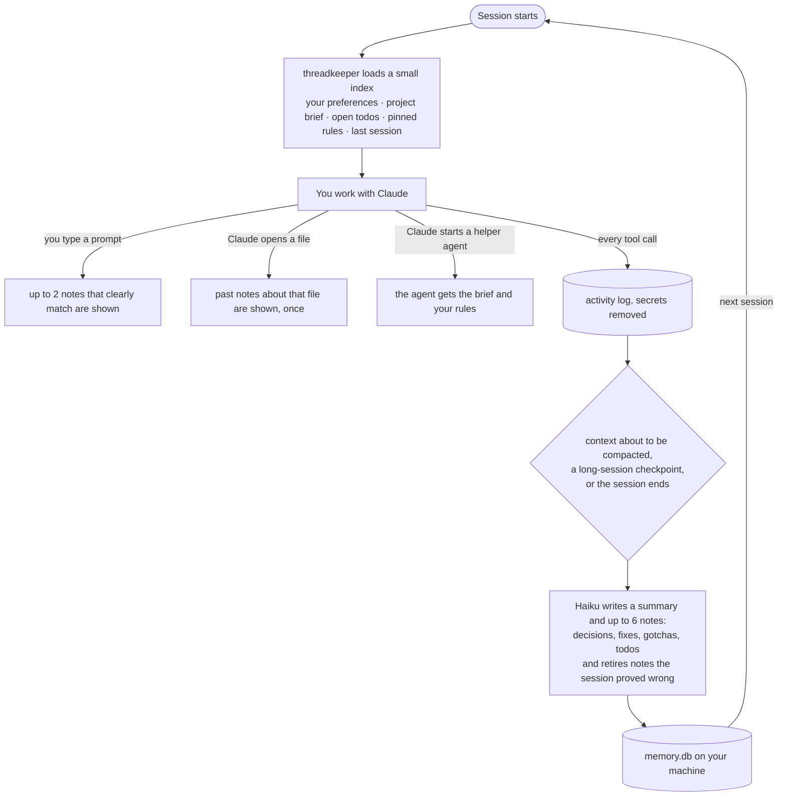
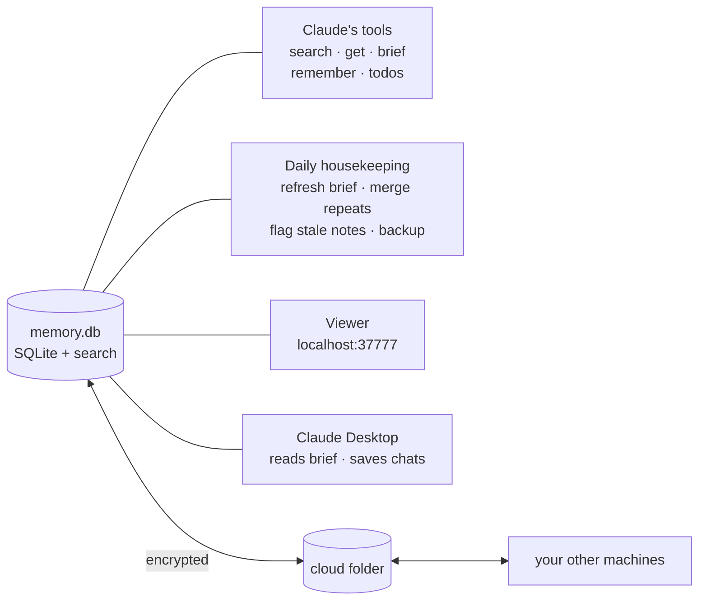

# threadkeeper

**Version 0.13.0** · [Changelog](CHANGELOG.md)

Personal, local-only memory for Claude Code. Built so Claude never loses its place: not after a long session, not after the context is compacted, not next week. No account, no hosted service, no extra dependencies. Inspired by [claude-mem](https://github.com/thedotmack/claude-mem); written from scratch to be small, local-only and token-lean.

## Why use it

- **Claude picks up where you left off.** Every session starts with what matters: what the project is, what you were doing, what's still open, and your rules. No more re-explaining the project or pasting last week's notes.
- **Long sessions don't lose the thread.** Before Claude Code compacts the conversation, the work so far is saved and handed straight back, so decisions and half-finished work survive.
- **Fewer tokens, not more.** It loads a short index (about 750 tokens at start), shows old notes only when they clearly match, never repeats itself, and stops Claude re-reading unchanged files, often the biggest waste in long sessions.
- **Hard-won lessons stick.** Bug causes, traps and decisions are saved with their reasons, so the same problem isn't debugged twice. Notes that turn out wrong are retired, and notes about rewritten files are flagged.
- **Your rules apply everywhere.** Say "always…" or "never…" once and it holds in every project, on every machine, including Claude's helper agents.
- **Private by design.** Everything stays on your machines in one SQLite file. No account, no server, no telemetry, and secrets are stripped before anything is saved. Sync between your machines is end-to-end encrypted.
- **Works across your setup.** macOS, Windows and Linux, Claude Code and Claude Desktop, with notes shared between machines through any cloud folder.
- **Zero maintenance.** It summarizes, merges duplicates, refreshes the project brief, tags notes for search and backs itself up in the background. A local viewer lets you see, search, edit and pin everything.

## How it works

**One session, start to finish**



**Around the memory**



## What it does

| When | What happens |
|---|---|
| You work | Hooks log your prompts and Claude's tool calls (redacted) into `~/.threadkeeper/memory.db`. Never slows Claude: logging hooks run in the background. |
| Context is about to be compacted | The session so far is summarized **before** compaction, then handed straight back after it: notes, your requests in this session, files changed, recent failures. |
| A session ends | `claude -p --model haiku` turns the log (plus Claude's own replies) into a summary and up to 6 notes: decisions, bug fixes, gotchas, discoveries, todos, each tied to the files it is about. Very long sessions also save partial summaries along the way. |
| A new session starts | The **project brief** (one up-to-date page: what the project is, architecture, current state, decisions in force, traps, open threads, how to work in it), open todos, pinned notes, and the latest session notes are loaded. |
| Notes pile up | Every dozen new notes, the summary model rewrites the brief, so thousands of notes stay usable in one page. |
| A fact changes | The summarizer sees earlier notes on the same files and topics, and marks the ones this session proved wrong as **outdated**: kept in history, never recalled again. |
| A long session runs | A checkpoint summary is saved (and synced) every 40 tool calls or 20 minutes of real work, so a crash or a switch to your other machine loses nothing. |
| Hooks didn't run | (for example the app was opened before Node was installed) threadkeeper finds the sessions it missed in Claude Code's transcripts, rebuilds and summarizes them, and tells you. Errors, failing summaries and a missing sync folder are flagged at session start and in the viewer. |
| You say "always…" / "never…" / "from now on…" | The summarizer saves it as a pinned rule that loads in every session, on every machine. |
| Once a day per project | In the background: notes about files that git deleted are retired, near-duplicate notes, and the step-by-step notes of one investigation ("suspect X", "X ruled out", "fixed by Y") once settled for 3 days, are merged into one note with the final answer (the first runs on a project do more, to clear imported history; on your imported notes this turns about 970 notes into 290), and the brief is refreshed if due. Todos untouched for 30 days stop loading at start (a one-line count points to them). |
| Claude Code's own memory files exist | `~/.claude/projects/<project>/memory/*.md` are brought in (feedback notes pinned) and synced to your other machines. |
| You type a prompt | Up to 2 older notes that clearly match what you asked (a good share of your words, at least one in the note's title) are shown to Claude as short lines, once each per session. Weak matches show nothing. |
| Claude opens a file | Up to 3 past notes about that file (gotchas and decisions first) are shown as short lines the first time it is read or edited in a session. |
| Work happens in one folder but is about another repo | (`cd ~/projects/x && …`, or a Claude Desktop scratch folder editing a real repo) the notes are saved to the repo the files belong to, so they don't clutter the wrong project and are found from the right one. |
| A session ends without a summary | (terminal closed, old version) it is summarized at the next session start in any project, not only when you reopen that project. |
| Claude starts a helper agent (Explore, Plan, …) | The agent gets the brief's Essentials and the pinned rules up front, instead of re-reading the code to find its way. |
| A file is heavily rewritten after a note about it | The note is labelled "files changed a lot since: check" wherever it shows up, so Claude checks the code before trusting it (checked daily from git). |
| You work in Claude Desktop | Desktop's Claude reads the project brief when a chat is about a project, and saves what the chat produced (`save_chat`: a summary plus key decisions and findings) so your Code sessions know it too. |
| You say "always…" about how you like to work (not about one project) | It is saved once as **your preference** and loads in every project, on every machine (and for helper agents). `remember` with `everywhere` does the same by hand. |
| Notes sync through a cloud folder | With `encrypt`, each machine's sync file holds only AES-256-GCM sealed notes. The key stays in `~/.threadkeeper/sync-key` on your machines, never in the cloud. Run `encrypt` once on the first machine (it prints the key; keep it in a password manager), then `encrypt <key>` on each other machine. A machine without the key waits and says so; it reads everything once the key is set. |
| Every day | A backup of the database is saved in `~/.threadkeeper/backups` (last 7 kept). `restore` lists them and brings one back. |
| You want to see your week | The viewer's **This week** tab (or `week`) lists per project what you worked on, what got done, decisions, hard-won lessons and todos. It is never loaded into Claude, so it costs no tokens. |
| Later work finishes a todo | The summarizer sees the open todos and closes the ones that got done. |

Search matches by meaning without a vector database: every note gets 6-10 related words from the summary model when it's written (older and imported notes get them in small background batches), so "database" finds the PostgreSQL note and "android deep link" finds the App Links one, with no model call at search time. Newer notes rank higher.

At session start you see one line, like `threadkeeper: 1,328 notes for my-app · loaded brief + ~750 tokens · http://localhost:37777`, so you know memory loaded. A bundled `memory` skill tells Claude when to search, when to read the full brief, and how to retire notes it proves wrong.

Claude also gets tools: `search` (when exact words find little, it asks the summary model for related terms, so "database" also finds PostgreSQL notes), `get`, `timeline` (what happened around a note), `remember` (save something now; say "remember that…", or "remember and pin…" for rules that must load every session), `brief`, `mark_outdated`, and `resolve_todo`.

Repeated notes are merged instead of piling up: a new note with the same title and type as a live one updates it.

## Viewer

Starts by itself with Claude Code at http://localhost:37777 and only answers on your own machine.

- **Overview** (click the logo): notes, sessions, todos and tokens at a glance, a 30-day activity chart, what kinds of notes you have, the latest notes, and the project brief Claude sees first.
- **Browse and search** every project (including imported claude-mem history). Notes are colour-coded by type, and search highlights matches (press `/`).
- **Keep memory accurate**: pin notes so they always load, edit, mark outdated or forget them, close todos, and see notes whose files changed a lot ("needs a check").
- **Replay sessions**: every prompt and tool call, with long runs folded and filters for your prompts or failures.
- Light, dark or automatic theme; keyboard shortcuts (press `?`); works on a phone-sized window.

Needs Node 22.13 or newer (uses the built-in `node:sqlite`). Run `node ~/threadkeeper/src/cli.mjs doctor` to check everything.

## Install / update

In Claude Code, on every machine (Mac, Windows, Linux):

```
/plugin marketplace add aboelnasrmo/threadkeeper
/plugin install threadkeeper@threadkeeper
```

Choose "Install for you", then restart Claude Code. Turn on **auto-update** for the `threadkeeper` marketplace in `/plugin` → Marketplaces, and every machine picks up new versions when Claude Code starts. Your data in `~/.threadkeeper` is kept and upgraded automatically.

If you installed Node while Claude Code or Claude Desktop was open, quit and reopen the app fully: it keeps its old PATH, can't find `node`, and threadkeeper silently records nothing.

The CLI lives inside the installed plugin; for a stable path, clone the repo too (`git clone https://github.com/aboelnasrmo/threadkeeper ~/threadkeeper`) and use its `src/cli.mjs`.

Keep the original claude-mem disabled in `/plugin` so the two don't both inject memory. To bring its history over:

```bash
node ~/threadkeeper/src/cli.mjs import-claude-mem
```

Imported notes attach to a project the first time you open Claude Code in a folder with the same name.

## Claude Desktop and other machines

**Claude Desktop (same Mac):** `node ~/threadkeeper/src/cli.mjs desktop`, then quit and reopen Claude Desktop. Desktop gets the same tools (`projects`, `search`, `todos`, `remember`…) on the same database; pass a project name, e.g. "search threadkeeper for deploy in my-app". Desktop has no hooks, so it saves a chat with `save_chat` near the end of chats that produced something, and anything you ask it to remember. Undo with `desktop remove`.

**Other machines:** never share `~/.threadkeeper` itself through a cloud drive (two machines writing one SQLite file corrupts it). Instead:

```bash
node ~/threadkeeper/src/cli.mjs sync "~/Library/CloudStorage/GoogleDrive-you@gmail.com/My Drive/threadkeeper-sync"
```

Each machine keeps its own database and appends only to its own file in that folder; every machine reads the others' files and the newest edit wins. Projects are matched by folder name, so `my-app` on a Mac and `my-app` on Windows share notes. After that it syncs by itself when Claude Code starts and after every summary. `forget` only wipes the local machine; forgetting a single note in the viewer removes it everywhere.

## Token use

threadkeeper loads a small index, not everything: the project brief (one page), open todos, pinned notes, the newest session in full, and only titles with `#id`s for older ones. When a project has a brief, fewer recent sessions are loaded because the brief already condenses them. Anything else stays one `search` / `get` away, so nothing is lost.

It also never says the same thing twice: a note loaded at session start is not repeated when Claude opens a related file or you mention its topic, and short replies ("ok", "go on") trigger no recall. A `--resume`d session gets only what changed since it was last active (its old conversation is already back), and after compaction only the brief, rules, todos and "this session so far" come back. The summary model gets a compressed log (file reads and searches counted, not listed; repeated commands merged), about a third smaller. `node src/cli.mjs usage` (and the viewer header) shows what threadkeeper actually cost over the last 7 days.

**Re-read guard.** The biggest token cost in long sessions is Claude reading the same file again. When Claude asks to re-read a file (3 KB or more) that it already read in full this session, that hasn't changed since and hasn't been compacted away, threadkeeper stops that one read and tells Claude the content is still above. If Claude really needs it (a subagent, or after a summary), the very next attempt goes through. Partial reads and subagents are never stopped. Turn it off with `"rereadGuard": false`. Savings show in `usage`. Measured on a 600-note project: about 750 tokens at session start (the brief's short Essentials section loads; the full page is one `brief` call away), about 110 per matching prompt and 140 per newly opened file with history. Raise `contextMaxChars` and friends in settings if you'd rather spend more.

## Troubleshooting by OS

Run `node <plugin folder>/src/cli.mjs doctor` first: it checks Node, the database, the `claude` command, the plugin, sync, encryption and backups, and says what to fix.

**All systems**
- *Nothing is recorded:* Node must be 22.13 or newer and on the PATH the app sees. If you installed Node while Claude Code or Claude Desktop was open, quit the app fully and reopen it.
- *No summaries:* the `claude` command must work in a terminal and be signed in. `doctor` shows whether it's found.
- *Another machine's notes don't appear:* both machines need the same sync folder (`sync <folder>`), and if encryption is on, the same key (`encrypt <key>`). `doctor` names the machine whose notes it can't open.

**macOS**
- Use the Google Drive / iCloud / Dropbox folder for sync, never the data folder itself.
- If `doctor` says Node is too old: `brew upgrade node`.

**Windows**
- Either Claude Code installer works: `claude.exe` (native) is used directly; an npm install (`claude.cmd`) is run through the shell.
- Paths are matched without regard to case, so `c:\work\app` and `C:\Work\App` are one project.
- If `restore` reports the file is busy, quit Claude Code and Claude Desktop and run it again.
- Run the tests in Git Bash or WSL (`bash test/run.sh`).

**Linux**
- The viewer opens with `xdg-open`; otherwise browse to http://localhost:37777.
- On a headless server, turn the viewer off with `"autoViewer": false` in settings.

## Commands

```bash
M=~/threadkeeper/src/cli.mjs
node $M viewer          # web viewer (also starts by itself with Claude Code): http://localhost:37777
node $M status          # counts, pending summaries, errors
node $M list            # notes for the current project
node $M todos           # open todos for the current project
node $M forget          # wipe the current project (or: forget --all)
node $M desktop         # connect Claude Desktop to the same memory
node $M sync <folder>   # sync with other machines through a shared folder
node $M brief [--refresh]   # show or rebuild the project brief
node $M recover [--all] [N] # rebuild sessions threadkeeper missed from Claude Code transcripts
node $M import-claude-memory # bring in Claude Code memory files from every project
node $M export [folder] [out]  # the project's memory as Markdown files (for Obsidian, backups)
node $M usage [days]    # tokens threadkeeper added to Claude's context, and summary-model calls
node $M doctor          # version, node, database, claude CLI, plugin, sync, Desktop, recent problems
```

Wrap anything in `<private>...</private>` in a prompt to keep it out of memory. API keys, tokens, passwords in `key=value` form and `.env` contents are redacted automatically.

## Settings

`~/.threadkeeper/settings.json`:

| key | default | meaning |
|---|---|---|
| `enabled` | `true` | master switch |
| `minToolCalls` | `5` | summarize only if a session edited a file or made at least this many tool calls |
| `model` | `haiku` | model for summaries |
| `contextSessions` | `4` | recent sessions loaded at start |
| `contextMaxChars` | `9000` | size cap on that context |
| `contextLooseNotes` | `6` | newest notes with no local session (synced from another machine, or imported) shown at session start |
| `fileContext` | `true` | show notes when Claude opens a file |
| `promptRecall` / `promptRecallMax` | `true` / `2` | show matching notes for each prompt |
| `ignoreProjects` | `[]` | folders never recorded, e.g. `["~/projects/secret"]` |
| `keepActivityDays` | `60` | raw activity log retention (notes are kept forever) |
| `autoViewer` / `viewerPort` | `true` / `37777` | start the web viewer in the background with the first Claude Code session |
| `brief` / `briefEvery` / `briefMaxChars` | `true` / `20` / `4500` | living project brief, refreshed after this many new notes |
| `checkpointTools` / `checkpointMinutes` | `60` / `30` | checkpoint summaries during long sessions |
| `smartSearch` | `true` | expand searches that find nothing with related terms |
| `importClaudeMemory` | `true` | import Claude Code's own memory files |
| `recoverMissed` | `true` | rebuild sessions the hooks missed from transcripts |
| `briefAtStart` | `essentials` | `essentials` = short section at start, full brief on demand; `full` = whole brief |
| `showStatus` | `true` | one "memory loaded" line for you at session start |
| `tagNotes` | `true` | background search tags for older notes (a few batched calls per project per day) |
| `rereadGuard` / `rereadMinBytes` | `true` / `3000` | stop re-reads of unchanged files still in context |

Problems are logged to `~/.threadkeeper/errors.log`; hooks never block Claude.

## Test

`npm test` runs the whole pipeline (capture, redaction, summaries, todos, compaction, MCP tools, import, viewer API, a browser test when Playwright is installed, and fuzz tests) against a fake `claude`.

`node test/bench.mjs 200000` measures speed at scale. On 200,000 notes (168 MB): session start 28 ms, file recall 28 ms, per-prompt recall 134 ms, project search 112 ms.

## Credits and license

Inspired by [claude-mem](https://github.com/thedotmack/claude-mem) by Alex Newman, which showed how useful memory across Claude Code sessions can be. This is an independent project written from scratch; it shares no code with claude-mem and is not affiliated with or endorsed by it. It can import your existing claude-mem history.

MIT licensed, see [LICENSE](LICENSE).

## Contributing

Issues and pull requests are welcome. Run `bash test/run.sh` before sending a change (needs Node 22.13+; uses a fake `claude`, so no model calls).

## License

MIT. Your notes never leave your machines (or the sync folder you choose); there is no telemetry.
